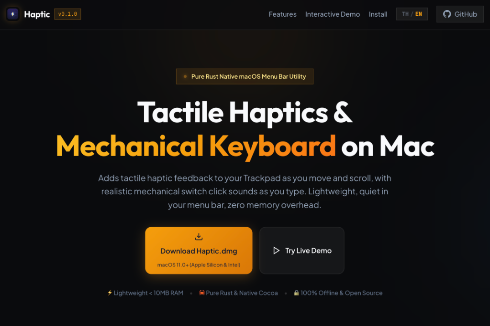

# ⚡️ Haptic for macOS

<p align="center">
  
</p>

<p align="center">
  <b>Add Haptic feedback (vibrations/subtle clicks) to your Trackpad and Mechanical Keyboard sounds on Mac</b>
  <sub>Written in Pure Rust & Native Cocoa • Lightweight, efficient <10MB RAM • Runs silently in Menu Bar</sub>
</p>

---

## Why This?

When using a MacBook or Magic Trackpad, scrolling through long pages feels smooth, but sometimes you miss that tactile feedback from a physical trackpad or mechanical keyboard. This app brings that satisfying haptic sensation back to your Mac!

## Features

- **Mouse Movement Haptic** — Subtle vibrations that respond to mouse movement distance
- **Scroll Wheel Haptic** — Rhythmic vibrations based on scroll speed and distance
- **Multi-Touch Gestures** — Haptic feedback for Pinch-to-zoom, Rotate (2-finger), Swipe gestures and more
- **Haptic Output Modes**:
  - **Trackpad Vibration Only (Default)**: Activates the Taptic Engine on your Trackpad
  - **Speaker Audio Tick**: Simulates subtle click sounds similar to Apple Watch / Digital Crown through your speaker instead
  - **Both (Trackpad + Speaker)**: Combines both vibration and subtle click sounds together
- **Mechanical Keyboard Sounds** — Low-latency keyboard click sounds (<2ms) while typing:
  - **Cream / Holy Panda (Thocky)**: Deep, warm, smooth tones
  - **Blue Switch (Crisp Click)**: Sharp, clear mechanical clicks
  - **Vintage Typewriter**: Classic typewriter key sounds
  - Adjustable volume levels: 100%, 70%, 40%, 15%, Mute
- **Menu Bar Controls** — Toggle each feature independently from the top-right menu
- **3 Intensity Levels**: Light, Medium, Firm
- **Adjustable Sensitivity**: Customize the threshold for how frequently haptic feedback triggers
- **System-Wide Support** — Works with any app regardless of which window is active

## Installation & Usage

1. Download `Haptic.dmg` from [Releases](https://github.com/iamapinan/haptic/releases)
2. Drag `Haptic.app` into your Applications folder
3. Open the app — a lightning bolt icon `⚡️` will appear in your top-right Menu Bar

> **Important: First Launch**  
> macOS will request **Accessibility** permission so the app can monitor mouse and keyboard input.  
> Grant permission via: `System Settings` ➜ `Privacy & Security` ➜ `Accessibility` ➜ Enable **Haptic**

---

## Build from Source

If you want to compile from source, you'll need Rust installed:

```bash
git clone git@github.com:iamapinan/haptic.git
cd haptic

# Run directly
cargo run --release

# Or bundle as .app / .dmg
./bundle.sh
./create_dmg.sh
```

## Requirements

- macOS 11.0 or later
- Compatible with MacBook Force Touch Trackpad, Apple Magic Trackpad, or standard mice (via Speaker Audio Tick mode)

## License

MIT License
